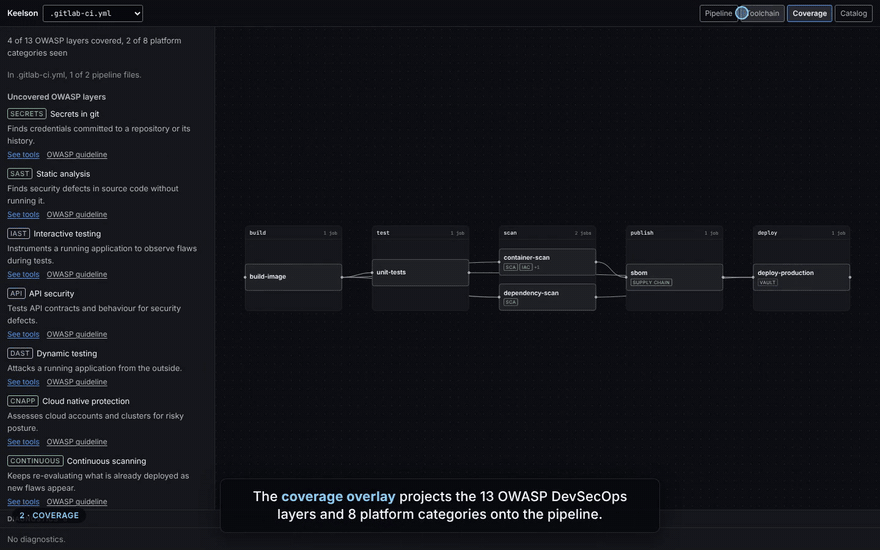
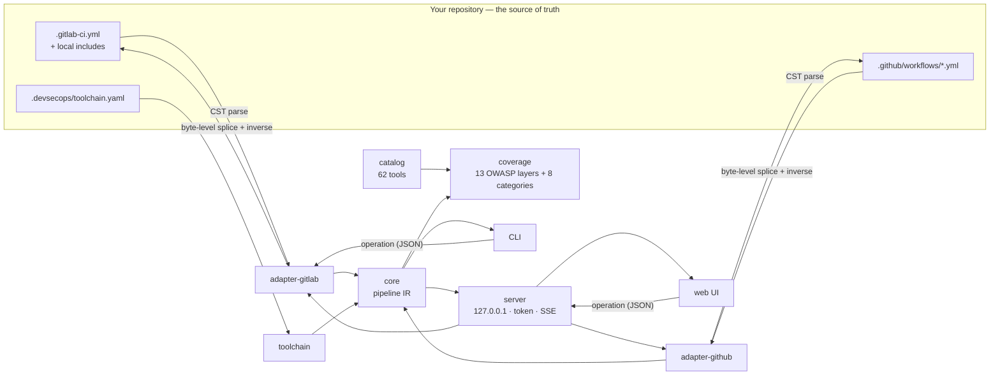

<div align="center">

<picture>
  <source media="(prefers-color-scheme: dark)" srcset="docs/assets/wordmark-dark.svg">
  
</picture>

### Design your DevSecOps chain visually — on top of the CI files you already have.

Keelson reads your native GitLab CI and GitHub Actions YAML, maps every job to the
[OWASP DevSecOps Guideline](https://owasp.org/www-project-devsecops-guideline/), shows what is
missing, and writes the fix back into your YAML — in place, byte for byte.

[](https://github.com/khalidOuhmid/keelson/actions/workflows/ci.yml)
[](https://github.com/khalidOuhmid/keelson/actions/workflows/codeql.yml)
[](LICENSE)
[](packages/cli/package.json)
[](https://owasp.org/www-project-devsecops-guideline/)
[](CONTRIBUTING.md)

[**Quick start**](#quick-start) ·
[**Documentation**](#documentation) ·
[**Demo video**](docs/demo/keelson-demo.mp4) ·
[**Roadmap**](#roadmap) ·
[**Contributing**](CONTRIBUTING.md)

<br>



</div>

---

## Table of contents

- [Why Keelson](#why-keelson)
- [Features](#features)
- [Quick start](#quick-start)
- [Usage](#usage)
  - [The web UI](#the-web-ui)
  - [Gate your CI on security coverage](#gate-your-ci-on-security-coverage)
  - [Edit a fleet of repositories](#edit-a-fleet-of-repositories)
- [How it works](#how-it-works)
- [Coverage model](#coverage-model)
- [Supported platforms](#supported-platforms)
- [Security model](#security-model)
- [Documentation](#documentation)
- [Roadmap](#roadmap)
- [Development](#development)
- [Contributing](#contributing)
- [License](#license)
- [Acknowledgements](#acknowledgements)

## Why Keelson

Security architecture reviews keep asking the same question: **which layers of the DevSecOps chain
does this pipeline cover, with which tools, and what is missing?** Today the answer lives either in a
diagram that drifted from the code months ago, or scattered across thousands of lines of CI YAML.

Keelson answers it from the repository itself:

- **The repository stays the source of truth.** No proprietary pipeline format. Keelson reads your
  `.gitlab-ci.yml` and `.github/workflows/*.yml` and writes changes back as minimal patches. A parse
  followed by an emit with no change is byte-identical — comments, key order, anchors included.
- **Coverage is computed, not declared.** Jobs are mapped to the 13 OWASP DevSecOps layers and 8
  platform categories by what they actually run.
- **Gaps come with implementations.** A curated catalogue of 62 tools proposes ready-to-insert jobs,
  previewed as a diff, for every uncovered layer.
- **It scales to a fleet.** Every edit is a serialisable operation, so one change can be reviewed
  once and replayed across hundreds of repositories.
- **It runs locally.** No account, no server, no telemetry. Your CI files never leave your machine.

## Features

| | |
| --- | --- |
| 🧭 **Pipeline view** | Stages, jobs, `needs` and environments — local `include:`, `extends` and anchors resolved on GitLab; dependency levels on GitHub, like GitHub's own graph, local reusable workflows and composite actions read for coverage. |
| ✍️ **Lossless editing** | Add, rename, remove jobs and needs, move stages, set environments, insert catalogue snippets. Every edit is a byte-level patch with an exact inverse, so undo always restores the original bytes. |
| 🛡️ **Coverage overlay** | 13 OWASP DevSecOps layers + 8 platform categories, detected from images, scripts (read as a minimal shell, so `echo "trivy"` is not Trivy) and `uses:` actions. |
| 🧰 **Catalogue** | 62 tools — Gitleaks, Semgrep, CodeQL, Trivy, Syft, Cosign, ZAP, Checkov, DefectDojo, Vault, Harbor… — with licence, detection rules and GitLab / GitHub snippets. |
| 🏗️ **Toolchain view** | Named platform services (Vault, Harbor, Nexus, DefectDojo, Sentry…) and their integrations with jobs, inferred from scripts and confirmed in `.devsecops/toolchain.yaml`. |
| 🚦 **CI gate** | `keelson coverage --require secrets,sca,sast` fails the build when a mandatory layer is missing. |
| 🚢 **Fleet edits** | `keelson apply ops.json repo-a repo-b …` — all or nothing per repository, `--dry-run` diffs, `--json` reports. |
| 📤 **Exports** | Markdown coverage reports, Mermaid diagrams, full JSON model. |

## Quick start

> [!NOTE]
> `keelson` 0.1.0 is release-ready but not yet on npm. Until the first release, run it from source;
> afterwards it is a single command: `npx keelson start`.

Requirements: [Bun](https://bun.com) ≥ 1.4 to build, Node.js ≥ 20 to run.

```sh
git clone https://github.com/khalidOuhmid/keelson && cd keelson
bun install --frozen-lockfile
bun run build
```

Try it on the bundled sample pipeline (the UI writes edits back, so work on a copy):

```sh
cp -r packages/ui/dev-fixture /tmp/keelson-demo
node packages/cli/dist/keelson.js start /tmp/keelson-demo
```

Or point it at your own repository:

```sh
node packages/cli/dist/keelson.js start /path/to/your/repo
```

## Usage

### The web UI

`keelson start` opens four views on the repository:

1. **Pipeline** — the graph of stages and jobs; select a job to see its needs, environment and the
   YAML Keelson does not model, shown verbatim.
2. **Coverage** — the OWASP overlay, uncovered layers, and a *See tools* link to the catalogue.
3. **Catalog** — filter by layer, licence and CI system; *Add to pipeline* previews the diff before
   writing.
4. **Toolchain** — platform services and proposed integrations to confirm or dismiss.

Every write is explicit, atomic and undoable. External edits to the files are picked up live.

### Gate your CI on security coverage

<details open>
<summary><b>GitHub Actions</b></summary>

```yaml
- name: Require security coverage
  run: npx keelson coverage --require secrets,sca,sast,supply-chain
```

</details>

<details>
<summary><b>GitLab CI</b></summary>

```yaml
security-coverage:
  stage: test
  image: node:22
  script:
    - npx keelson coverage --require secrets,sca,sast,supply-chain
```

</details>

```text
covered  secrets                   Secrets in git  gitleaks
covered  sca                       Software composition analysis  dependency-scan, container-scan
missing  sast                      Static analysis
error COVERAGE_LAYER_MISSING required layer "sast" (Static analysis) is not covered
```

### Edit a fleet of repositories

Compute a change once, review it, replay it everywhere:

```json
{
  "v": 1,
  "baseHash": "0000000000000000000000000000000000000000000000000000000000000000",
  "kind": "addJob",
  "job": { "id": "secret-detection", "stage": "test", "script": ["gitleaks git --redact"] }
}
```

```sh
keelson apply add-secret-scan.json services/* --rebase --dry-run   # unified diff per repository
keelson apply add-secret-scan.json services/* --rebase --json      # apply, machine-readable report
```

Each repository is all or nothing: its file is written once, atomically, only if every operation
succeeds; one failing repository does not stop the others. See the [CLI reference](docs/cli.md).

## How it works



1. **Parse.** Each adapter parses the YAML with its concrete syntax tree, so every node knows its
   exact byte range, and builds a provider-neutral pipeline IR. What the IR does not model (scripts,
   `rules`, `strategy`…) is kept as opaque blocks, byte for byte.
2. **Analyse.** The catalogue's detection rules map jobs to layers; the toolchain file adds declared
   services; `validate` checks needs, cycles and stages.
3. **Edit.** The UI and the CLI never write YAML directly: they send an operation
   `{ v, baseHash, kind, … }`. The adapter turns it into a minimal patch, re-parses the result before
   anything is written, and returns the inverse patch. A stale `baseHash` is refused.

Design decisions are recorded as [architecture decision records](specs/adr/).

## Coverage model

| OWASP DevSecOps layer | Example tools in the catalogue |
| --- | --- |
| Secrets in git | Gitleaks, TruffleHog, detect-secrets, ggshield |
| Software composition analysis | OSV-Scanner, Grype, Trivy, Dependency-Track, Renovate |
| Static analysis | Semgrep, CodeQL, SonarQube, Bandit, gosec |
| Infrastructure as code | Checkov, KICS, TFLint, Trivy |
| Supply chain | Syft, Cosign, CycloneDX CLI, Witness, OpenSSF Scorecard |
| Interactive testing | Contrast Assess, DongTai IAST |
| API security | Schemathesis, Spectral, 42Crunch, ZAP |
| Dynamic testing | ZAP, Nuclei, Nikto, Burp Suite DAST |
| Cloud native protection | Falco, Kubescape, Prowler, Wiz |
| Infrastructure scanning | Trivy, Grype, OpenVAS, kube-bench, Lynis |
| Continuous scanning | Trivy Operator, Dependency-Track, Kubescape, OpenVAS |
| Compliance | Chef InSpec, OpenSCAP, Prowler, kube-bench, Conftest |
| AI and LLM security | garak, promptfoo, ModelScan |

Plus 8 **platform categories** the guideline does not cover but every real chain needs: source
control, artifact registries, secrets management, vulnerability aggregation, code quality server,
runtime observability, runtime security and policy as code.

## Supported platforms

| | Read | Coverage | Edit in the UI | `keelson apply` |
| --- | :---: | :---: | :---: | :---: |
| GitLab CI (`.gitlab-ci.yml`, local `include:`) | ✅ | ✅ | ✅ | ✅ |
| GitHub Actions (`.github/workflows/*.yml`) | ✅ | ✅ | ✅ | planned |
| Remote GitLab includes (`project:`, `remote:`, `template:`) | reported | — | — | — |

## Security model

`keelson start` is a local server that can write files, so it defends itself against the other pages
open in your browser:

- binds to **`127.0.0.1` only**, with no option to listen elsewhere;
- checks the **`Host` header** before anything else (DNS-rebinding defence);
- requires a **per-session 32-byte token**, compared in constant time and removed from the address
  bar after load;
- serves **only the files it detected**, refuses symlinks that leave the repository, caps request
  bodies at 1 MB;
- writes **atomically** (temporary file, `fsync`, `rename`) through one queue per document, with
  idempotent operation ids.

Details in [specs/01-plan.md §7b](specs/01-plan.md). To report a vulnerability, see
[SECURITY.md](SECURITY.md).

## Documentation

| | |
| --- | --- |
| [CLI reference](docs/cli.md) | Every command, option, exit code, and the operation format |
| [Configuration](docs/configuration.md) | `.devsecops/toolchain.yaml`, `.devsecops/layout.json`, catalogue entries |
| [Error codes](specs/diagnostics.md) | Every diagnostic and refusal, with the shape of its `params` |
| [Architecture decisions](specs/adr/) | Why the system is built the way it is |
| [Technical plan](specs/01-plan.md) | Model, round-trip guarantees, server API, security model |
| [Known gaps](specs/gaps.md) | Everything known to be missing, with impact and proposed fix |
| [Changelog](CHANGELOG.md) | Release notes |

## Roadmap

All planned milestones (L0–L8) are delivered — see the [delivery log](specs/progress.md). Next:

- [ ] Publish `keelson@0.1.0` on npm with provenance
- [ ] `keelson apply` on GitHub workflows and on `.devsecops/toolchain.yaml`
- [x] Resolve local reusable workflows and composite actions on GitHub
- [ ] Cached resolution of remote GitLab includes
- [ ] More CI systems (Azure Pipelines, Jenkins, CircleCI)

Ideas and requests are welcome in [issues](https://github.com/khalidOuhmid/keelson/issues).

## Development

```text
packages/
  core            pipeline + toolchain IR, operations, diagnostics, messages
  adapter-gitlab  GitLab CI ↔ IR, lossless editing
  adapter-github  GitHub Actions ↔ IR, lossless editing
  taxonomy        OWASP layers + platform categories
  catalog         tools/*.yaml, schema, detection, compiled catalog.json
  toolchain       .devsecops/toolchain.yaml, layout.json, integration proposals
  server          local HTTP + SSE server
  ui              React 19 + Vite + Tailwind CSS v4
  cli             the `keelson` binary, bundled for Node
```

```sh
bun install --frozen-lockfile
bun run check        # lint + typecheck + build + unit tests — what CI runs
bun run e2e          # Playwright end-to-end tests on the real binary
bun run dev          # local server on a sample pipeline + UI with hot reload
```

Engineering principles:

- **Test-driven.** Property tests (fast-check) check round-trip, invertibility, determinism and edit
  locality over 34 GitLab files (20 official templates), 11 multi-file include trees and 22 MIT
  workflows from `actions/starter-workflows`. Playwright tests drive the real built binary.
- **Bun for tooling, Node for users.** Runtime packages use no Bun API, enforced by the type checker
  and a dedicated guard; CI smoke-tests the bundled binary on Node 20, 22 and 24.
- **Errors are contracts.** Every error is `{ code, params }`, documented; no prose on the wire.

## Contributing

Contributions are welcome — bug reports with a minimal CI file, new catalogue entries, new CI
systems. Start with [CONTRIBUTING.md](CONTRIBUTING.md) and please follow the
[Code of Conduct](CODE_OF_CONDUCT.md).

## License

Keelson is licensed under the [Apache License 2.0](LICENSE). Copyright 2026 Khalid Ouhmid.
Bundled third-party components and their licences are listed in
[THIRD_PARTY_NOTICES.md](packages/cli/THIRD_PARTY_NOTICES.md).

## Acknowledgements

- The [OWASP DevSecOps Guideline](https://owasp.org/www-project-devsecops-guideline/), whose layers
  structure the coverage model.
- [Simple Icons](https://simpleicons.org) (CC0) for tool logos. Logos are trademarks of their
  respective owners.
- The official [GitLab CI templates](https://gitlab.com/gitlab-org/gitlab) and
  [GitHub starter workflows](https://github.com/actions/starter-workflows) (MIT), used as a test
  corpus.
- [`yaml`](https://github.com/eemeli/yaml), [React Flow](https://reactflow.dev),
  [elkjs](https://github.com/kieler/elkjs) and [CodeMirror](https://codemirror.net).
