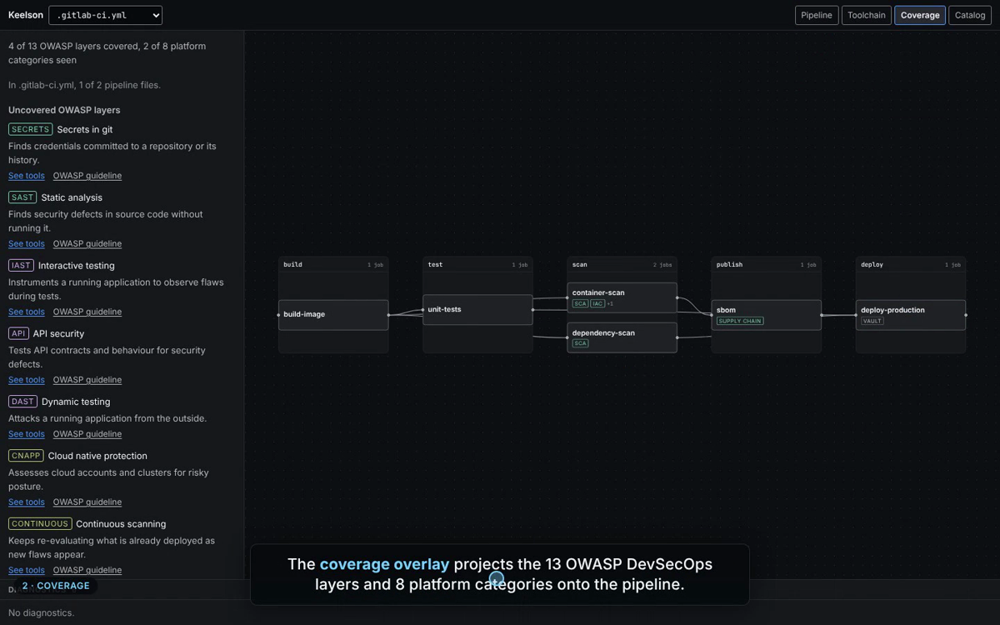
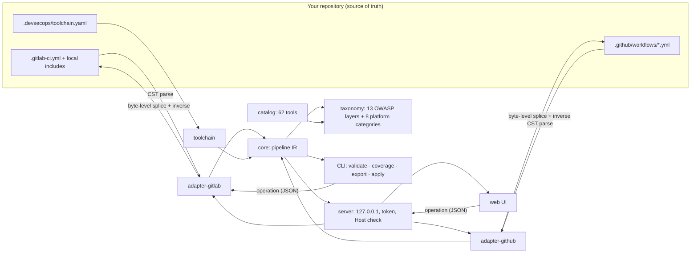

# Keelson

[](https://github.com/khalidOuhmid/keelson/actions/workflows/ci.yml)
[](LICENSE)
[](packages/cli/package.json)
[](https://owasp.org/www-project-devsecops-guideline/)

**Design your DevSecOps chain visually, on top of the CI files you already have.**

Keelson reads your native CI YAML, draws the pipeline, projects the 13 layers of the
[OWASP DevSecOps Guideline](https://owasp.org/www-project-devsecops-guideline/) onto it, models the
platform services around it (Vault, Harbor, DefectDojo, Nexus, Sentry…), and proposes concrete,
catalogued tools for every layer you do not cover yet. Then it writes the change back into your
YAML — in place, byte for byte, comments and anchors preserved.

[](docs/demo/keelson-demo.mp4)

*Click the image for the 2-minute demo: pipeline, OWASP coverage, closing a gap from the catalogue,
toolchain, editing a GitHub Actions workflow, CI gate and fleet apply.*

Runs locally on Node ≥ 20. Nothing leaves your machine. Apache-2.0.

## Try it in 60 seconds

`keelson` 0.1.0 is ready to publish but not on npm yet, so `npx keelson start` will only work after
the first release. From a clone ([Bun](https://bun.com) ≥ 1.4 to build, Node ≥ 20 to run):

```sh
git clone https://github.com/khalidOuhmid/keelson && cd keelson
bun install --frozen-lockfile
bun run build

# the UI writes edits back to the file it opened: work on a copy of the sample pipeline
cp -r packages/ui/dev-fixture /tmp/keelson-demo
node packages/cli/dist/keelson.js start /tmp/keelson-demo

# the CI gate: exits 1 because the sample has no SAST job
node packages/cli/dist/keelson.js coverage /tmp/keelson-demo/.gitlab-ci.yml --require secrets,sast

# the same pipeline as a Mermaid diagram
node packages/cli/dist/keelson.js export /tmp/keelson-demo/.gitlab-ci.yml --format mermaid
```

On your own repository: `node packages/cli/dist/keelson.js start /path/to/repo`.

## Why

Platform teams design security chains in diagram tools that drift from the code, or directly in YAML
where the big picture is lost. Neither answers the question an architecture review actually asks:
*which security layers does this pipeline cover, with what, and what is missing?*

Keelson answers it from the repository itself, keeps the repository as the source of truth, and
scales the answer to a fleet of repositories.

## What it does

| | |
| --- | --- |
| **Pipeline view** | Stages, jobs and `needs` from `.gitlab-ci.yml` (local `include`, `extends`, anchors resolved) and from `.github/workflows/*.yml` (jobs laid out by dependency level). |
| **Lossless round-trip** | GitLab CI and GitHub Actions edits are patches on the original bytes. Parse → emit with no change is byte-identical; every edit returns a `splice` inverse. Verified by fast-check property tests (round-trip, inverse, determinism, locality) over 34 GitLab files — 20 official templates and 14 hand-written edge cases — plus 11 multi-file include trees, and 22 MIT workflows from `actions/starter-workflows`. |
| **Coverage overlay** | 13 OWASP DevSecOps layers plus 8 platform categories, detected from job images, scripts (read as a minimal shell, not grepped) and GitHub Actions `uses:`. |
| **Toolchain view** | Named service instances (`.devsecops/toolchain.yaml`) and their integrations with jobs: push, upload-report, fetch-secret, notify. Inference proposes, the file decides. |
| **Catalogue** | 62 tools with licence, logo, detection patterns and ready-to-insert GitLab and GitHub snippets. Insertion is previewed as a diff before anything is written. |
| **Fleet** | `keelson apply ops.json repo-a repo-b …` replays the same serialisable operations across N repositories, all-or-nothing per repository, with `--dry-run` diffs and `--json` output for automation. |
| **CI gate** | `keelson coverage --require secrets,sca,sast` exits non-zero when a required layer is missing. |

## How it works



Every edit is a serialisable operation `{ v, baseHash, kind, … }`. Each adapter turns it into a
patch on the original bytes and returns the inverse patch. The same JSON drives the UI, undo/redo,
`--dry-run` diffs and fleet replay — which is why a fleet edit is just a file.

## Commands

```sh
keelson start [dir] [--port <n>] [--no-open]                  # local web UI (free port by default)
keelson validate [file] [--format text|json]                  # pipeline + toolchain diagnostics
keelson coverage [file] [--require <layers>] [--format text|json]  # exit 1 if a required layer is missing
keelson export [file] [--format markdown|mermaid|json]        # default: markdown
keelson catalog lint [dir]                                    # no dir: lint the embedded catalogue
keelson apply <ops.json> [repo...] [--file <path>] [--rebase] [--dry-run] [--json]  # fleet edits
```

Without `[file]`, `validate`, `coverage` and `export` cover every CI file of the repository
(`.gitlab-ci.yml` and `.github/workflows/*.yml`); name one file to restrict them.
`keelson <command> --help` prints the usage of one command.

### Fleet example

```sh
# one operation file, rebased on each repository's current text
cat > add-gitleaks.json <<'JSON'
{ "v": 1, "baseHash": "0000000000000000000000000000000000000000000000000000000000000000",
  "kind": "addJob",
  "job": { "id": "secrets", "stage": "test", "script": ["gitleaks git --redact"] } }
JSON

keelson apply add-gitleaks.json services/* --rebase --dry-run   # review the diffs
keelson apply add-gitleaks.json services/* --rebase --json      # apply, machine-readable report
```

Each repository is applied independently: one without a `test` stage or a `.gitlab-ci.yml` is
reported as failed and the others are still written; the exit code is 1 if any repository failed.
Without `--rebase`, the placeholder `baseHash` is rejected as stale.

## Security model of the local server

`keelson start` binds to `127.0.0.1` only, checks the `Host` header (DNS-rebinding defence),
requires a per-session 32-byte token compared in constant time, serves only the files it detected,
refuses symlinks that leave the repository, caps request bodies at 1 MB, and writes atomically
(temp file, `fsync`, `rename`) through a per-document queue with idempotent operation ids. Details:
[specs/01-plan.md §7 ter](specs/01-plan.md).

## Support matrix

| | Read | Coverage | Edit |
| --- | --- | --- | --- |
| GitLab CI (`.gitlab-ci.yml`, local includes) | yes | yes | yes |
| GitHub Actions (`.github/workflows/*.yml`) | yes | yes | yes, in the UI (`keelson apply`: GitLab only for now) |

## Project layout

```
packages/core            pipeline + toolchain IR, operations, diagnostics, messages
packages/adapter-gitlab  GitLab CI ↔ IR, CST-based lossless editing
packages/adapter-github  GitHub Actions ↔ IR, CST-based lossless editing
packages/taxonomy        OWASP layers + platform categories
packages/catalog         tools/*.yaml, schema, detection, compiled catalog.json
packages/toolchain       .devsecops/toolchain.yaml, layout.json, integration proposals
packages/server          local HTTP + SSE server
packages/ui              React 19 + Vite + Tailwind v4
packages/cli             the `keelson` binary (bundled for Node)
```

Design notes are in French: architecture decisions in [specs/adr/](specs/adr/), public error codes
in [specs/diagnostics.md](specs/diagnostics.md), the plan in [specs/01-plan.md](specs/01-plan.md),
the delivery log in [specs/progress.md](specs/progress.md), known gaps in
[specs/gaps.md](specs/gaps.md) — index in [specs/README.md](specs/README.md). Product principles
and the design system are in [PRODUCT.md](PRODUCT.md) and [DESIGN.md](DESIGN.md); `CLAUDE.md`,
`.claude/` and `.impeccable/` hold the AI-assisted workflow configuration used to build the project.

## Engineering

- TDD throughout. Property tests (fast-check) check round-trip, invertibility, determinism and edit
  locality over the corpus (provenance and SHA in
  `packages/adapter-gitlab/test/corpus/LICENSES.md`).
- Runtime packages are Bun-free, built for Node with `bun build --target=node`, enforced by
  per-package `types: ["node"]` and `scripts/check-runtime.ts`. CI smoke-tests the bundled binary
  under Node 20, 22 and 24.
- End-to-end Playwright tests run against the real built binary.
- Every error code is a documented public contract; nothing on the wire carries prose.
- 13 architecture decision records in [specs/adr/](specs/adr/).

Run everything CI runs: `bun run check && bun run e2e`.

## Status and roadmap

All planned lots (L0–L8) are delivered; see [specs/progress.md](specs/progress.md). Next up:

- publish `keelson@0.1.0` to npm (a `v*` tag triggers `.github/workflows/release.yml`, with
  provenance);
- `keelson apply` on GitHub workflows and on the toolchain file (the UI already edits both);
- local reusable workflows and composite actions on GitHub; cached resolution of remote GitLab
  `include:` (`project:`, `remote:`, `template:`), which are reported but not resolved today.

Every known gap is logged with its impact and a proposed fix in [specs/gaps.md](specs/gaps.md).

## Contributing

See [CONTRIBUTING.md](CONTRIBUTING.md). Security reports: [SECURITY.md](SECURITY.md).

## Licence

Apache-2.0 — Copyright 2026 Khalid Ouhmid. Bundled third-party components:
[packages/cli/THIRD_PARTY_NOTICES.md](packages/cli/THIRD_PARTY_NOTICES.md).
